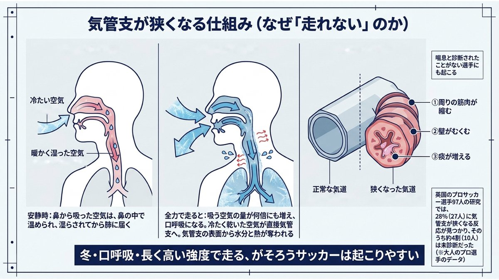
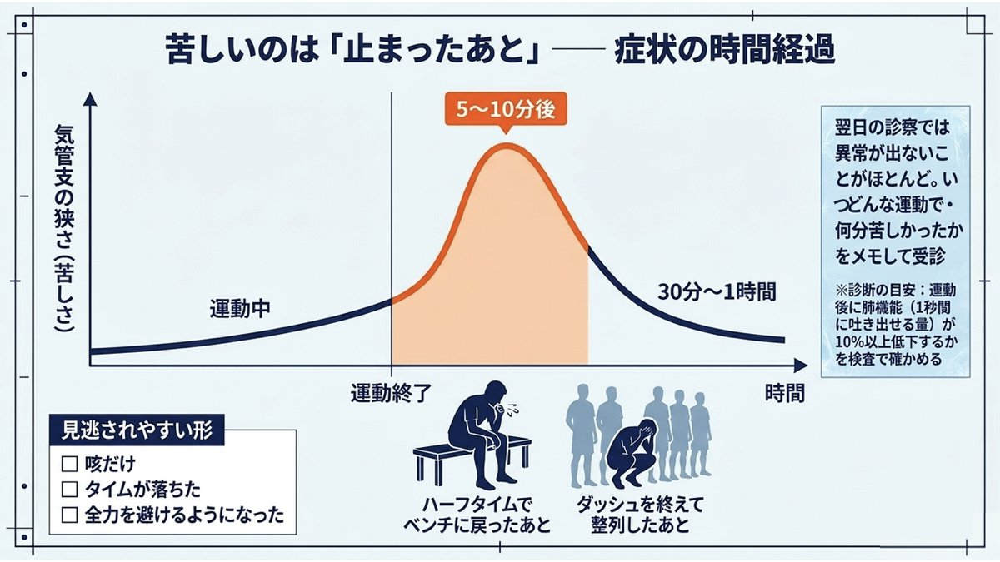
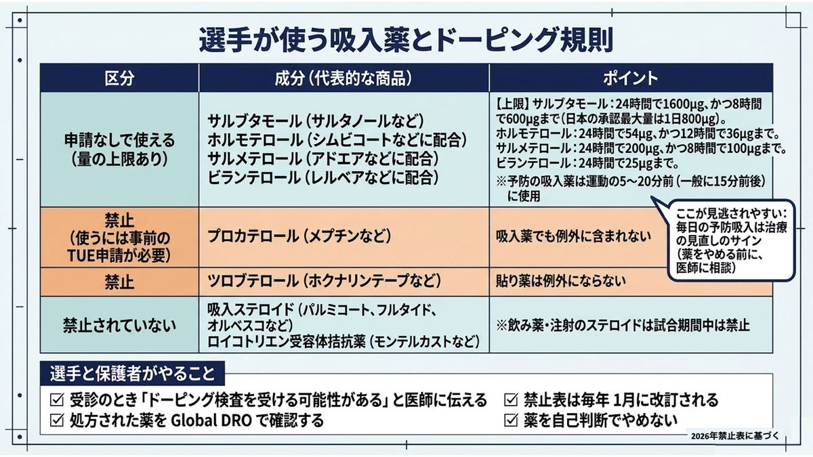
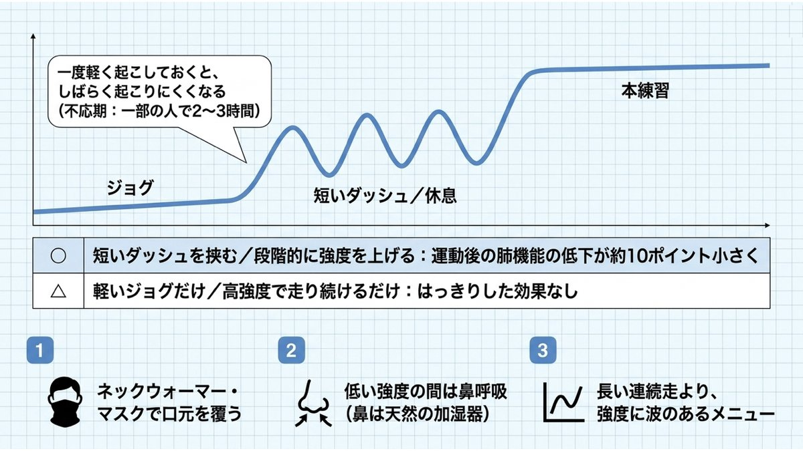
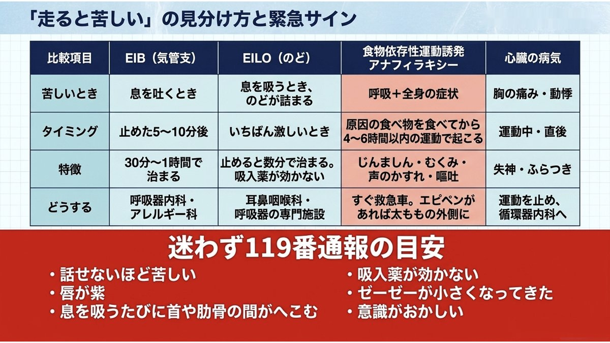

# 運動誘発性気管支収縮（EIB）｜冬に走ると咳が出て苦しいサッカー選手へ、救急医が解説

> **【この記事の要約】** 寒くなると、走ったあとに咳が止まらない、息が吐きにくい。それは体力不足ではなく、気管支が一時的に狭くなる**運動誘発性気管支収縮（EIB）**かもしれません。冷たく乾いた空気を大量に吸うことで起こり、**喘息と診断されたことがない選手にも起こります。** 英国のプロサッカー選手97人の検査では**28%**に見つかり、その約4割は未診断でした。症状は**運動を止めた5〜10分後**に強くなるのが特徴です。予防の基本は運動前の吸入薬と、**高強度を含むウォームアップ**です。そして選手にとって大事な注意点として、日本でよく処方される**メプチン（プロカテロール）とホクナリンテープ（ツロブテロール）は、2026年のドーピング規則で禁止されています。**

11月に入ると、毎年同じ相談が増えます。

「夏はあんなに走れたのに、最近すぐ息が上がる」「練習が終わって少ししてから、咳が止まらなくなる」「試合の後半になると胸が締めつけられる」。

本人も指導者も、まず体力が落ちたと考えます。走り込みが足りない、気持ちが弱い。ところが、走り込みを増やすほど悪くなる選手がいます。

その中に、**気管支そのものが狭くなっている**選手が混ざっています。今回は、冬に増えるこの「走れない」の正体と、薬を使う選手が知っておくべきドーピングの注意点まで書きます。

## 1. EIBとは：運動で気管支が一時的に狭くなる

**運動誘発性気管支収縮（EIB：Exercise-Induced Bronchoconstriction）**は、運動をきっかけに気管支（肺の中の空気の通り道）が一時的に狭くなる状態です。

以前は「運動誘発性喘息」と呼ばれていました。名前が変わったのは、**喘息のない人にも起こる**ことが分かってきたからです。米国胸部学会（ATS）の診療ガイドライン（2013年）も、EIBは喘息のある人の多くに起こる一方で、喘息と診断されていない人にも起こると整理しています。

### なぜ狭くなるのか

鍵は、**吸い込む空気の量と、その空気の乾き具合**です。

安静にしているとき、吸った空気は鼻を通る間に温められ、湿らされてから肺に届きます。ところが全力で走ると、1分間に出入りする空気の量が何倍にも増え、呼吸は口呼吸に切り替わります。温める・湿らせる仕組みが追いつかないまま、外の空気が直接気管支に流れ込みます。

すると、気管支の表面から**水分と熱が奪われます。** 表面を覆う水分が蒸発して濃くなる（浸透圧が上がる）ことが刺激になり、気管支の周りの細胞から気管支を縮める物質が放出されます。その結果、

- 気管支の周りの筋肉が縮む
- 気管支の壁がむくむ
- 痰が増える

の3つが重なって、空気の通り道が狭くなります。

### 冬とサッカーが重なると起こりやすい

冷たい空気は、もともと含める水分の量が少なく、乾いています。**冬の屋外で、口呼吸で、長い時間高い強度で走り続ける。** サッカーは、EIBが起こりやすい条件がそろった競技です。

さらに、アレルギー性鼻炎や花粉症がある選手、子どもの頃に喘息があった選手は、気管支が敏感になっていて起こりやすいとされています。

<figure style="margin:24px 0;text-align:center;">
  
  <figcaption style="font-size:0.85rem;color:var(--text-light,#666);margin-top:6px;">冬・口呼吸・長く高い強度で走る。この3つがそろうと、気管支の表面から水分と熱が奪われる</figcaption>
</figure>

## 2. サッカー選手にどれくらいいるのか

英国のプロサッカー選手**97人**を、気管支の反応を調べる検査（乾いた空気を一定時間、速く深く吸い続けてもらい、前後の肺機能を比べる検査）で調べた研究（Jacksonら、2018年）があります。

- **28%（27人）**で、気管支が狭くなる反応が見つかった
- そのうち**約4割（10人）**は、それまで喘息やEIBと診断されたことがなかった
- 吸入薬で治療すると、気管支が狭くなる程度が軽くなった

トップレベルで走り続けている選手でも、**4人に1人以上が気管支の問題を抱え、しかもその一部は本人も気づいていなかった**ということです。

ただし、これは大人のプロ選手のデータです。日本の高校生でどのくらいの割合かを示す同じ形の調査はありません。「高校サッカー選手の28%がEIB」という意味ではないことに注意してください。

## 3. 症状：苦しさのピークは「止まったあと」

EIBのいちばんの特徴は、**症状が強くなるタイミング**です。

運動中から苦しくなることもありますが、典型的には**運動を止めてから5〜10分後**に気管支が最も狭くなります。ハーフタイムにベンチへ戻ったあと、ダッシュの本数をこなして整列したあとに、激しく咳き込み始める。そして多くは、何もしなくても**30分から1時間ほど**で元に戻ります。

このため、翌日に病院へ行くころには、診察しても聴診しても**まったく異常がない**ことがほとんどです。

<figure style="margin:24px 0;text-align:center;">
  
  <figcaption style="font-size:0.85rem;color:var(--text-light,#666);margin-top:6px;">苦しさのピークは運動中ではなく、止めてから5〜10分後</figcaption>
</figure>

### よくある訴え

- 運動後に咳が止まらない（**咳だけ**のことも多い）
- 息が**吐きにくい**、胸が締めつけられる
- ゼーゼー、ヒューヒューという音がする
- 以前より明らかに走れない、タイムが落ちた

### 見逃されやすい形

EIBは、**典型的なゼーゼーがないまま、「体力がない」「やる気がない」に見える**ことがあります。苦しくなるのが怖くて、無意識に全力のスプリントを避けるようになる選手もいます。

逆に、症状だけで判断するのも危険です。ATSのガイドラインも、**症状だけではEIBかどうかは決められない**としています。似た症状の病気がいくつもあるからです（第7節）。

## 4. 診断：検査で「狭くなる」ことを確かめる

EIBの診断は、**運動などで気管支に負荷をかけて、実際に狭くなることを確かめる**のが基本です。

- **運動負荷試験**：走る前と後で肺機能（1秒間に吐き出せる量）を測り、運動後に一定以上下がるかを見る。ガイドラインでは**10%以上の低下**がひとつの基準
- **乾いた空気を速く深く吸い続ける検査**など：第2節の研究で使われた方法
- **安静時の肺機能検査、呼気NO検査**：背景に喘息（慢性の気道の炎症）があるかを調べる

安静時の検査が正常でも、EIBは否定できません。「走ったあとに苦しくなる」という情報が大事なので、**いつ、どんな運動で、どのくらいの時間苦しかったか**をメモして受診してください。スマートフォンで咳き込んでいる様子を動画に撮っておくのも役に立ちます。

受診先は、**呼吸器内科、アレルギー科、小児科（中学生）**が目安です。

## 5. 治療と、選手だけが気をつけるべき「ドーピング」の話

### 治療の基本

ATSのガイドラインが強く推奨しているのは、**運動の5〜20分前（一般に15分前後）に、気管支を広げる吸入薬（短時間作用性β2刺激薬）を使う**ことです。効果は数時間続きます。

ただし、注意点が2つあります。

1. **毎日使い続けると、効きが弱くなる。** 体が薬に慣れてしまうためです。毎日の予防吸入が必要な状態なら、主治医と治療を見直すべきサインです
2. **背景に喘息があるなら、炎症を抑える治療が土台になる。** 吸入ステロイドを毎日使う、ロイコトリエン受容体拮抗薬（飲み薬）を加えるなどです。喘息がある場合、気管支を広げる薬だけで治療することは現在の国際的な指針では勧められていません

### ドーピング規則：日本でよく処方される2つの薬が禁止されている

ここが、選手と保護者にいちばん知っておいてほしいところです。

気管支を広げる薬（β2作用薬）は、世界アンチ・ドーピング機構（WADA）の禁止表で**原則として常に禁止**されています。例外として、決められた量の範囲内なら申請なしで使えるのは、次の4つの**吸入薬**だけです（**2026年禁止表**）。

| 成分（代表的な商品） | 申請なしで使える上限 |
|---|---|
| サルブタモール（サルタノールなど） | 24時間で1600μg、かつ8時間で600μgまで。※日本で承認されている最大量は1日800μg |
| ホルモテロール（シムビコートなどに配合） | 24時間で54μg、かつ12時間で36μgまで |
| サルメテロール（アドエアなどに配合） | 24時間で200μg、かつ8時間で100μgまで |
| ビランテロール（レルベアなどに配合） | 24時間で25μgまで |

裏を返すと、**この4つ以外の気管支拡張薬は、吸入薬でも禁止**です。日本の診療で特に問題になるのが次の2つです。

- **メプチン（プロカテロール）**：日本では発作止めの吸入薬として広く処方されますが、例外の4成分に含まれていません。使うには**事前に治療使用特例（TUE）の申請と承認**が必要です
- **ホクナリンテープ（ツロブテロール）**：子どもによく処方される貼り薬です。**吸入薬ではないため、例外になりません**

一方で、次の薬は禁止されていません。

- **吸入ステロイド**（パルミコート、フルタイド、オルベスコなど）。ただし、**飲み薬や注射のステロイドは試合期間中は禁止**です
- **ロイコトリエン受容体拮抗薬**（モンテルカストなど）

### 選手と保護者がやること

- 受診のとき、**「ドーピング検査を受ける可能性がある」**と医師に伝える。全国大会、国スポ、年代別代表などに関わる選手は特に
- 処方された薬は、JADA（日本アンチ・ドーピング機構）の薬検索サービス**Global DRO**で、成分名や商品名から確認する
- 禁止表は**毎年1月に改訂**されます。去年大丈夫だった薬が今年も大丈夫とは限りません
- 薬を**自己判断でやめない。** 変更は必ず医師と相談する

この節の内容は、執筆時点（2026年11月）の2026年禁止表に基づいています。

<figure style="margin:24px 0;text-align:center;">
  
  <figcaption style="font-size:0.85rem;color:var(--text-light,#666);margin-top:6px;">メプチンとホクナリンテープは禁止。迷ったらGlobal DROで確認し、薬は自己判断でやめない</figcaption>
</figure>

## 6. 薬に頼らない対策：ウォームアップと冬の工夫

### ウォームアップに「高強度」を入れる

EIBには、**一度軽く起こしておくと、その後しばらく起こりにくくなる**という性質があります（不応期）。EIBのある人の一部では、この状態が2〜3時間続くとされています。

これを利用するのがウォームアップです。ウォームアップの効果を調べたランダム化比較試験7本をまとめた研究（Sticklandら、2012年）では、

- **高強度のダッシュを間に挟むウォームアップ**、**低強度から高強度まで段階的に上げるウォームアップ**は、運動後の肺機能の低下を約10ポイント小さくした
- 一方、**ゆっくり走るだけの軽いウォームアップ**や、**高い強度で走り続けるだけのウォームアップ**では、はっきりした効果は確認できなかった

という結果でした。

つまり、**軽いジョグだけでも、いきなり全力でもなく、軽い運動から始めて短いダッシュを何本か挟む**のがよいということです。サッカーのアップでいえば、ジョグ・ストレッチのあとに、短いダッシュと休みを数本繰り返してから本練習に入る形です。

### 冬の屋外での工夫

- **ネックウォーマーやマスクで口と鼻を覆う。** 吸い込む空気が温かく湿った状態になります。ATSのガイドラインも、寒い環境では口元を覆うことを勧めています
- **低い強度の間は鼻呼吸を意識する。** 鼻は空気を温めて湿らせる天然の加湿器です
- **長い時間の連続走より、強度に波のあるメニューにする**
- 花粉や大気汚染がひどい日は、症状が出やすいことを知っておく

<figure style="margin:24px 0;text-align:center;">
  
  <figcaption style="font-size:0.85rem;color:var(--text-light,#666);margin-top:6px;">軽いジョグだけでも、いきなり全力でもなく、短いダッシュを挟んでから本練習へ</figcaption>
</figure>

### 指導者の方へ

冬の練習は、**いきなり外に出てすぐ高強度**という流れを避けてください。そして、ダッシュのあとに咳き込む選手を見たら、「根性が足りない」ではなく、**一度受診を勧めてください。** 第2節のプロ選手の研究でも、本人が気づいていない選手が少なくありませんでした。

## 7. EIBと間違えやすい病気（ここが救急医として一番伝えたいこと）

「走ると苦しい」の中には、EIBではない病気が混ざっています。中には命に関わるものもあります。

### ① 運動誘発性喉頭閉塞（EILO）：のどが閉じる

激しい運動の最中に、**のどの入り口（声帯のあたり）が狭くなる**状態です。思春期から若い世代の選手に多いとされています。

| | EIB（気管支） | EILO（のど） |
|---|---|---|
| 苦しいとき | **息を吐くとき** | **息を吸うとき**。のどが詰まる感じ |
| 苦しくなるタイミング | 運動を**止めた5〜10分後**が最も強い | 運動が**いちばん激しいとき** |
| 治まるまで | 30分〜1時間 | 運動を止めると**数分で**治まる |
| 吸入薬 | 効く | **効かない** |

**「喘息の吸入薬を使っているのに、試合中の苦しさが変わらない」**という選手は、EILOを疑う手がかりになります。EIBと両方を持っている選手もいます。診断には、運動しながらのどをカメラで観察する専門的な検査が必要で、耳鼻咽喉科や呼吸器の専門施設で相談します。

### ② 食物依存性運動誘発アナフィラキシー：食べてから運動すると起こる

特定の食べ物（小麦、甲殻類など）を食べたあとに運動すると起こる、**命に関わるアレルギー反応**です。JFAスポーツ医学委員会は、**原因の食べ物を食べてから4〜6時間以内の運動**で起こると説明しています。

- 最初は**全身が熱い、じんましん、だるさ**
- 悪化すると**手足や顔のむくみ、声のかすれ、のどの腫れ、腹痛・嘔吐・下痢、ふらつき・意識が遠のく**
- **ゼーゼーという喘息のような症状**が出ることもある

EIBとの違いは、**皮膚や顔、お腹の症状を伴う**ことです。JFAは、痛み止めの服用、寒い・暑い環境、花粉症、月経なども起こりやすくする条件に挙げています。[試合前の痛み止め](/blog/posts/nsaids-before-match-2026/)の記事で書いた薬が、ここでも関わってきます。

疑ったら**すぐに運動を止め、救急車を呼び、エピペンを持っていれば太ももの外側に打ちます。**

### ③ 心臓の病気

運動中や運動直後に、**胸の痛み、動悸、失神（気を失う）、ふらつき**がある場合は、呼吸ではなく心臓を疑います。特に**運動中に気を失った**ことがある選手は、運動を続ける前に必ず循環器内科で調べてもらってください。家族に若くして突然亡くなった人がいる場合も同じです。

### ④ そのほか

- **貧血**：酸素を運ぶ力が落ちて、走れなくなります。[スポーツ選手の隠れ貧血](/blog/posts/2026-06-08-iron-deficiency-anemia/)
- **オーバートレーニング**：練習量と回復のバランスが崩れた状態です。[オーバートレーニング症候群](/blog/posts/2026-07-19-overtraining-syndrome/)
- **単純な体力の問題、緊張による過呼吸**：過呼吸では手足や口のまわりのしびれを伴うことがあります

## 8. その場でできること：発作が起きたら

練習中に選手が咳き込み、苦しそうにしていたら、

1. **運動を止めて座らせる。** 上半身を少し前に傾けた姿勢が楽なことが多い
2. **処方されている発作止めの吸入薬があれば使う**
3. 落ち着いて声をかけ、**ゆっくりした呼吸**を促す

EIBなら、多くは30分〜1時間で落ち着きます。

**次の場合は、迷わず119番通報してください。**

- **話せない**、文章で話せないほど苦しい
- **唇や顔色が紫・灰色っぽい**
- 息を吸うたびに、**首の付け根や肋骨の間がへこむ**
- 吸入薬を使っても**良くならない**
- ゼーゼーという音が**むしろ小さくなってきた**（空気がほとんど通っていない危険なサインです）
- **じんましん・むくみ・声のかすれ・嘔吐**を伴う（アナフィラキシー）
- **意識がおかしい**、呼びかけに反応が鈍い

呼びかけに反応がなく、普段どおりの呼吸がなければ、すぐに胸骨圧迫とAEDです。[心臓振盪とAEDの記事](/blog/posts/commotio-cordis-aed-2026/)に手順を書いています。

<figure style="margin:24px 0;text-align:center;">
  
  <figcaption style="font-size:0.85rem;color:var(--text-light,#666);margin-top:6px;">吸うときに苦しいならEILO、皮膚やお腹の症状があればアナフィラキシー、失神なら心臓を疑う</figcaption>
</figure>

## まとめ

- **冬に「走ると咳が出て苦しい」は、体力不足ではなくEIBのことがある**
- 冷たく乾いた空気を大量に吸うことで、**気管支が一時的に狭くなる**。喘息と言われたことがない選手にも起こる
- 英国のプロ選手97人では**28%**に見つかり、**約4割は未診断**だった（大人のプロ選手のデータ）
- 苦しさのピークは**運動を止めた5〜10分後**。30分〜1時間で治まるので、翌日の診察では異常が出ない
- 診断は症状だけで決めず、**運動などで負荷をかける検査**で確かめる
- 予防の基本は**運動15分前後の吸入薬**。ただし**毎日使うなら治療の見直し**を
- **メプチン（プロカテロール）とホクナリンテープ（ツロブテロール）はドーピング規則で禁止**（2026年禁止表）。検査の可能性がある選手は医師に伝え、Global DROで確認する
- ウォームアップは**軽い運動に短いダッシュを挟む形**が効果的。冬はネックウォーマーで口元を覆う
- **吸うときに苦しい・吸入薬が効かない**ならEILO、**食後の運動でじんましんやむくみ**ならアナフィラキシー、**失神や胸の痛み**なら心臓を疑う

冬の「走れない」を、気持ちの問題で片づけないでください。苦しくなるのが怖くて全力を出せなくなっている選手が、正しい診断と少しの工夫で、また最後まで走れるようになることは珍しくありません。

※本記事の図解5点は、当サイトが収集・整理した医学資料をもとに Google Gemini で作成したものです。

関連する記事もあわせてどうぞ。「走れない」の別の原因として[スポーツ選手の隠れ貧血](/blog/posts/2026-06-08-iron-deficiency-anemia/)と[オーバートレーニング症候群](/blog/posts/2026-07-19-overtraining-syndrome/)、連戦での回復については[中2日のリカバリー](/blog/posts/recovery-between-matches-2026/)、倒れた選手への対応は[心臓振盪とAED](/blog/posts/commotio-cordis-aed-2026/)に書いています。

> ※本記事は一般的な医学情報の提供を目的としたもので、個別の診断・治療に代わるものではありません。運動時の咳や息苦しさが続く場合は、呼吸器内科・アレルギー科・小児科を受診してください。ドーピング規則は毎年改訂されます。本記事のドーピングに関する記載は2026年禁止表に基づくもので、薬の使用可否は必ず最新の禁止表とGlobal DRO、または主治医・スポーツファーマシストに確認してください。内容は執筆時点で参照可能な診療ガイドライン・原著論文・公的機関の情報に基づいています。
