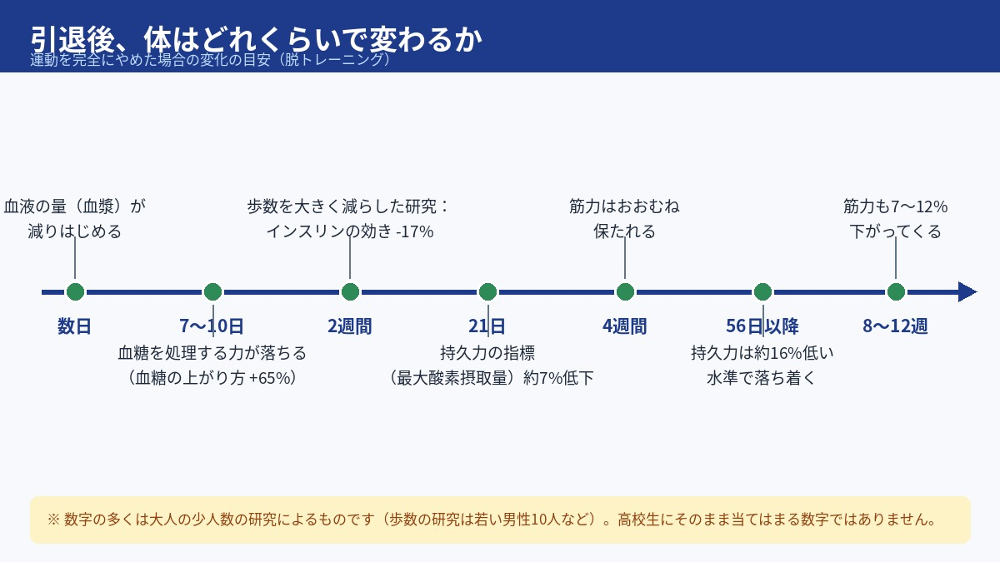
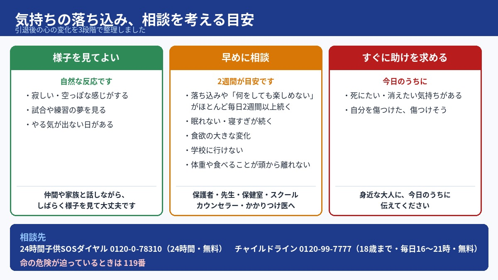

# 部活を引退すると太る？体力はどれくらいで落ちる？｜高校サッカー3年生の引退後の体と心、燃え尽きまで救急医が解説

> **【この記事の要約】** 部活を引退すると、体は思ったより早く変わりはじめます。運動を止めて**1〜2週間**で血糖を処理する力が落ち、持久力の指標（最大酸素摂取量）は**3週間で約7%**下がったという報告があります。一方で**筋力は4週間ほどはおおむね保たれます。** 国の基準で計算すると、部活をしていた頃と座って過ごす受験生活では、1日に使うエネルギーに**約650〜750kcal**の差が出ます。それでも**食べる量は自然には減りにくい**ため、引退後に体重が増えるのは意志の問題ではありません。おすすめは、急にゼロにするのではなく**「回数と時間を減らしても、きつさは保った運動を残す」**ことです。一般の大人を対象にした研究では、持久力は**週2回**、筋力は**週1回**でも、強度を保てば維持できたと報告されています。心の面では、気持ちが空っぽになるのは自然な反応ですが、**気分の落ち込みがほとんど毎日2週間以上続くとき**は、一人で抱えずに相談してください。朝どうしても起きられない状態は、怠けではなく**起立性調節障害**という病気のこともあります。大学で続ける人は、**ブランク明けに急に負荷を上げない**こと、**暑さへの慣れも失われている**ことを忘れないでください。

## 1. 導入：最後の笛のあとに起きること

11月は、全国のあちこちで3年生の最後の試合が終わる季節です。

選手権の予選で負けた日、あるいは最後の大会を終えた日。その翌日から、朝練も、放課後の練習も、週末の試合もなくなります。何年も続いてきた生活のリズムが、ある日を境にぷつりと途切れます。

私自身も、高校3年生で引退したあとは、進路をどうするかで悩み、探すことに多くの時間を使いました。サッカーに直接ではなくても関われる道はないか。そう考えて志したのが、医学の道でした。

ただ、それまで勉強はあまり進められていませんでした。引退後は勉強に全振りしましたが、一度では届かず、浪人の期間を経て大学に入りました。

引退のあとに起きる変化は、体と心の両方にあらわれます。

- 体重が増えた、階段で息が切れるようになった
- 食べる量は変わらないのに、お腹まわりが気になる
- 時間ができたのに、何もやる気が出ない
- 自分が何者なのか分からないような、ぽっかりした感じがある

どれも、多くの3年生が経験することです。そして、そのほとんどは**体と心の自然な反応**で、異常ではありません。

ただ、仕組みを知っておけば必要以上に不安にならずにすみますし、知っておくべき「相談したほうがいいサイン」もあります。今回は、体の変化を研究の数字で確認しながら、心の変化、受験期の過ごし方、大学で続ける人への注意まで、順番にお伝えします。

## 2. 体は何日で変わるか：持久力・筋肉・血糖の時間軸

### 運動をやめると起こること＝「脱トレーニング」

トレーニングで身についた体の変化が、練習をやめたり大きく減らしたりすることで失われていくことを、スポーツ医学では**脱トレーニング（ディトレーニング）**と呼びます。

この分野の代表的な総説（たくさんの研究をまとめた論文）が、スペインのMujika（ムヒカ）とPadilla（パディーヤ）による2000年の2部作で、4週間未満を「短期」、それより長いものを「長期」と分けて整理しています。

**最初にお断りしておきます。** この分野の研究の多くは、**大人の持久系の選手やトレーニング経験者を、少人数で調べたもの**です。高校生のサッカー選手を同じ形で調べた研究は多くありません。数字は「大人ではこういう報告がある」という目安として読んでください。

### 数日〜：血液の量が減りはじめる

最初に変わるのは、意外にも**血液の量**です。総説では、トレーニングをやめて**数日で**、全身の血液量、特に血液の液体部分（血漿）が減りはじめるとされています。

血液が減ると心臓が1回に送り出せる量が減り、同じペースでも心拍数が上がりやすくなります。「前より息が上がる」原因の一つです。

### 1〜2週間：血糖を処理する力が落ちる

次に変わるのが、**血糖（血液中のブドウ糖）を処理する力**です。

血糖を下げるのはインスリンというホルモンで、トレーニングを続けている人は、これがよく効く状態（インスリン感受性が高い状態）にあります。ところが、この状態は意外なほど早く失われます。

- よく鍛えた持久系の選手8人が**7〜10日間**運動をやめた研究（Arcieroら、1998年）では、ブドウ糖を飲んだあとの血糖の上がり方（血糖の曲線の下の面積）が**65%**、インスリンの出方が**約73%**大きくなりました。同じ血糖を下げるのに、より多くのインスリンが必要になったということです
- 健康な若い男性10人が、1日の歩数を約**1万500歩から約1,300歩**に減らして**2週間**過ごした研究（Krogh-Madsenら、2010年）では、インスリンの効き具合が**17%**低下し、持久力の指標が**7%**下がり、**脚の筋肉の量**も減っていました

Mujikaらは別の総説（2001年）で、こうした代謝の変化は**トレーニングをやめて10日以内に起こりうる**とまとめています。

病気になるという意味ではなく、運動を再開すれば戻る変化です。ただ、「動かない生活」の影響が思った以上に早くあらわれることを示しています。

### 3週間〜2か月：持久力の指標が下がる

持久力の代表的な指標が、**最大酸素摂取量**（体が1分間に取り込める酸素の最大量。持久力の「エンジンの大きさ」にあたります）です。

持久系のトレーニングを積んだ7人が練習をやめ、84日間追跡された研究（Coyleら、1984年）では、最大酸素摂取量は**最初の21日間で約7%**下がり、**56日目以降は、もとより約16%低い水準**で落ち着きました。それでも84日目の時点で、**運動習慣のない人よりは高い**ままでした。Mujikaらの総説（2000年、長期編）でも、よく鍛えた選手が4週間以上トレーニングを大きく減らすかやめると、最大酸素摂取量は**6〜20%**下がり、ただし**多くは運動していない人より高い水準で止まる**と整理されています。

一方、**始めて日が浅い人**では、身についた分がほぼすべて元に戻ることが多いとされます。長く鍛えた体ほど「貯金」が残りやすいのです。

### 筋力は4週間ほどはおおむね保たれる

持久力に比べると、**筋力は落ちにくい**ことが分かっています。

Mujikaらの総説（2001年）では、**筋力は全体として4週間程度の休止ならおおむね保たれる**とされています。たとえば、パワー系の競技選手12人が筋力トレーニングを**14日間**やめた研究（Hortobágyiら、1993年）では、

- ベンチプレスの重さは、ほとんど変わらなかった（**−1.7%**、統計的な差なし）
- 太ももの**ブレーキをかけながら力を出す筋力**（伸張性筋力）は**12%**下がった
- **速く強い力を出す筋線維（速筋線維）**は**6.4%**細くなっていた

という結果でした。重いものを持ち上げる力は残っていても、**着地や切り返しで体を止める力、競技特有の瞬発力**は、もう少し早く落ちる可能性があります。この点は、第8節の「ブランク明けの怪我」にもつながります。

なお、筋力トレーニングを積んだ選手でも、**8〜12週間**休むと筋力は**7〜12%**下がると報告されています（Mujikaら、2000年の総説）。

### 高校生年代のサッカー選手のデータ

高校生年代に近いデータもあります。スペインのクラブに所属する**14〜16歳のサッカー選手37人**を、**4〜8週間の夏休み**の前後で調べた研究（Amigóら、1998年）では、練習のない夏休みのあと、太ももの筋線維が**遅筋・速筋のどちらも細くなり**、エネルギーを作る酵素の働きも下がっていました。数週間の休みで、10代の選手の筋肉にもはっきりした変化が起きるということです。

<figure style="margin:24px 0;text-align:center;">
  
  <figcaption style="font-size:0.85rem;color:var(--text-light,#666);margin-top:6px;">最初に落ちるのは血液の量と血糖の処理。持久力が続き、筋力はいちばん最後</figcaption>
</figure>

## 3. 食習慣だけが残る問題：消費が落ちても、食べる量は落ちない

引退した3年生から、いちばんよく聞く悩みが「太った」です。

### 数字で見る：使うエネルギーは1日約650〜750kcal減る

厚生労働省の「日本人の食事摂取基準（2025年版）」は、ふだんの体の動かし方（身体活動レベル）を「低い」「ふつう」「高い」の3段階に分け、1日に必要なエネルギーの目安（推定エネルギー必要量）を示しています。男性の値は次のとおりです。

| 年齢 | 低い（生活の大部分が座って過ごす） | ふつう | 高い（スポーツなど活発な運動習慣がある） |
|---|---|---|---|
| 15〜17歳 | 2,500kcal | 2,850kcal | 3,150kcal |
| 18〜29歳 | 2,250kcal | 2,600kcal | 3,000kcal |

部活をしていた頃を「高い」、受験勉強で座っている時間がほとんどの生活を「低い」とすると、その差は**15〜17歳で約650kcal、18歳以上では約750kcal**になります。部活の時間がなくなっただけで、毎日これだけ「使う量」が減るということです。

ただし、これは**標準的な体格**（15〜17歳男性なら体重約60kg）を想定した目安で、計算そのものにも100〜200kcal程度の誤差がありえます。練習量や体格によって、実際の差は人それぞれです。

### 食欲は、運動量に合わせて自然には減らない

使う量が減っても、食べる量は自然には減ってくれません。

若い男性6人に、**よく体を動かす1週間**と、**ほとんど座って過ごす1週間**を、どちらも好きなだけ食べられる条件で過ごしてもらった研究（Stubbsら、2004年）があります。

- 1日に使うエネルギーは、座って過ごした週のほうが**約740kcal少なかった**（上の表の差とほぼ同じ大きさです）
- ところが、食べた量の差は**約200kcal**で、統計的にははっきりした差にならなかった
- その結果、座って過ごした週は、**7日間で体にたまったエネルギーが、動いた週の2倍以上**になった

※論文ではエネルギーをMJ（メガジュール）で示しており、kcalは換算した概算です。

**動かなくなっても、食欲はほとんど変わらない**ということです。少人数・1週間の大人の研究ですが、引退後に起こることをよく説明しています。

### 部活の頃の「食べる習慣」が残る

高校サッカー部の3年生は、何年も「たくさん食べること」を求められてきました。大きな弁当、練習後の補食、山盛りのご飯。**それ自体は、練習していた頃には正しい習慣**でした。

引退後に起こるのは、**練習はなくなったのに、食べる習慣だけが残る**というずれです。そこに受験勉強中の間食や甘い飲み物、夜食、ストレスや退屈からの「なんとなく食べ」が重なります。体重が増えるのは、こうしたずれが積み重なるからで、**意志が弱いからではありません。**

### どう調整するか

おすすめは、**減らすより、ずれを直す**ことです。

- 部活の頃の量を**惰性で食べていないか**見直し、まずは主食（ご飯・パン・麺）の量を少し調整する
- **甘い飲み物と、だらだら食べる間食**を減らす
- 食事は抜かない（朝食を抜くと勉強の集中にも響きます）
- **体を動かす習慣を少しでも残す**（第4節）

逆に注意してほしいのが、**太るのが怖くて極端に食べなくなる**ことです。高校生の体はまだ成長の途中で、十分な栄養が必要です。食事を抜く、特定の食べ物を極端に避ける、体重や体型のことが頭から離れない、食べることが怖い——こうした状態があるときは、保護者や学校の先生、かかりつけ医に相談してください。食べる量が体の必要に対して慢性的に足りない状態（相対的エネルギー不足：REDs）は、ホルモンや骨、鉄の状態にも影響します（[スポーツ選手の隠れ貧血](/blog/posts/2026-06-08-iron-deficiency-anemia/)の記事でも触れています）。

## 4. 急にやめるより「落としていく」：テーパリングという考え方

### 練習量を減らしても、体力は意外と保てる

ここで、明るい話をひとつ。

体力を保つのに必要な「最小限の運動量」を調べた研究をまとめた総説があります（Spiering、Mujikaら、2021年）。主に**一般の大人**を対象にした研究から、次のように報告されています。

- **持久力（最大酸素摂取量など）**：練習の回数を**週2回**まで減らしても、あるいは1回の時間を**3分の1（13分ほど）**まで短くしても、**強度（きつさ）を保てば**、最大15週間保たれた
- **筋力**：**週1回・各種目1セット**でも、**最後の1回がやっと上がるくらいの重さ**を保てば、最大32週間保たれた。20〜35歳の若い大人では、筋肉の太さも保たれた
- 逆に、回数と時間はそのままでも、**強度を下げると持久力の指標（最大酸素摂取量）は保てなかった**

著者らの結論は「体力を保つうえで、いちばん大事なのは強度」です。選手を対象にしたMujikaらの総説（2000年）も、**量（時間・距離）は60〜90%減らしても、強度を保てば数週間は体力を保てることがある**としています。試合前に量を落として疲れを抜く「テーパリング」と同じ考え方です。

ただし、持久力の研究は「回数を減らす」と「時間を減らす」を**別々に試したもの**で、両方を同時に減らした場合は確かめられていません。よく鍛えた選手では、回数は2〜3割減までにとどめるのが目安ともされています（Mujikaら、2000年）。著者らも**競技選手向けの具体的な目安にはデータが足りない**としており、高校生の研究でもありません。

### 引退後の3年生に当てはめると

そもそも**引退後に目指すのは、選手としての体力ではなく、健康な体と毎日の調子を保つこと**です。そのうえで、考え方は使えます。

- **ゼロにしない。** 引退した翌週から、まったく動かない生活にしない
- **週に2回くらい、短くても息が上がる運動を入れる。** 20〜30分のランニング、坂道ダッシュ、なわとび、フットサル、後輩の練習に混ざる、など。大事なのは時間の長さより、**ときどき「きつい」と感じる強さ**です
- **筋力トレーニングを週1回でも残す。** 自宅でできるスクワット、腕立て伏せ、体幹トレーニングでも構いません。楽にこなせる回数ではなく、**最後の数回がきつくなる**くらいを目安にしてください
- **日常の歩く量を落とさない。** 1駅歩く、階段を使う

世界保健機関（WHO）の2020年の指針では、5〜17歳の子ども・若者には、**平均して1日60分の、中くらい〜強い強度の運動**がすすめられています。あわせて、**すべての年代で筋肉を鍛える運動を定期的に行うこと、座っている時間を減らすこと**も勧めています。部活ほどの量は必要ありませんが、「ゼロ」と「少し」の差は大きいのです。

### 「体が落ちること」を責めない

体力が落ちるのは**自然な変化**で、長く鍛えてきた体は、動けば戻ります。受験の追い込みで運動できない時期があってもかまいません。大事なのは、**そのまま一生動かない生活に移ってしまわないこと**です。

## 5. 燃え尽き症候群と、うつ状態との違い：自分で見分けようとしなくていい

### 燃え尽き（バーンアウト）とは

スポーツの世界で「燃え尽き」と呼ばれる状態は、スポーツ心理学の研究者Raedeke（レデキ）とSmith（スミス）が2001年に整理し、測るための質問票（15問）を作りました。その考え方では、燃え尽きは次の**3つが重なった状態**です。

1. **心と体の消耗**：練習や試合で、心も体もへとへとに疲れきっている
2. **達成感の低下**：頑張っても上達している感じがしない、うまくいかない
3. **競技への気持ちが離れる**：サッカーが前ほど大事に思えない、どうでもよくなる

もともとは**競技を続けている選手**の状態として研究されてきた概念で、最後のシーズンにすでにこの状態にあった人もいるでしょう。

なお、練習量と回復のバランスが崩れて体の調子が落ちる「オーバートレーニング症候群」とは、重なる部分もありますが別のものです（[オーバートレーニング症候群](/blog/posts/2026-07-19-overtraining-syndrome/)の記事を参照）。

### うつ状態との違いは、専門家でも難しい

燃え尽きとうつ状態は、**疲れやすさ、興味がわかない**といった共通点が多く、どこまで別のものかは議論が続いています。大まかには、燃え尽きは**競技に関わる部分**に、うつ状態は**生活全体**（友だち、好きだったこと、食事や睡眠）に広がることが多いとされます。

ただし、**自分がどちらにあたるかを決める必要はありません。** 見分けるのは専門家の仕事です。大事なのは名前をつけることではなく、**「つらさが続いているときに、相談すること」**です。その目安は第9節にまとめます。

### 「空っぽ」は、多くの人に起こる自然な反応

引退してしばらく、

- 何をしてもしっくりこない
- 時間ができたのに、ぼーっとしてしまう
- 試合の夢を見る、仲間と練習していた時間が恋しい
- 「もっとやれたのではないか」と考えてしまう

と感じるのは、**何年も打ち込んできたものを失ったときの自然な反応**です。悲しんでいいし、寂しがっていいのです。多くの場合、新しい生活のリズムができるにつれて、少しずつ落ち着いていきます。

### 運動を急にやめること自体も、気分に影響する

気持ちの変化には、**運動をやめたこと自体**も関わっている可能性があります。ふだん運動している健康な人に、実験として運動をやめてもらった19の研究（計689人）をまとめた総説（Weinsteinら、2017年）では、運動をやめると**気分の落ち込みや不安が一貫して強まり**、やめた期間が**2週間を超えると影響が大きくなる**傾向がありました。一方で、治療が必要なほど重い状態になることはまれでした。

高校生を対象にした研究ではありませんが、第4節の「ゼロにしない」は、体だけでなく気持ちのためにもおすすめです。

## 6. アイデンティティの喪失（athletic identity）：病気ではないが、しんどい

### 「サッカー部の〇〇」でなくなる

スポーツ心理学には、**競技者アイデンティティ（athletic identity）**という言葉があります。アメリカの心理学者Brewer（ブルーワー）らが1993年に提唱した考え方で、「**自分のことを、どれくらい"競技者"として捉えているか**」の度合いを指します。

毎日の生活も、友だちも、目標も、サッカーを中心に回ってきた3年生にとって、「サッカー部の〇〇」はそのまま自分自身だったかもしれません。それ自体は**悪いことではありません。** 打ち込む力や仲間との絆を支えてきたものです。ただ、それが**自分のほぼすべて**になっていると、引退したときに「自分には何が残っているのか」という感覚が強くなりやすいと考えられています。

### 研究で分かっていること

**自分で選んだ引退ではない場合**のつらさも研究されています。イングランドのプロクラブの育成組織に所属する**15〜18歳の選手91人**を、契約継続の決定の前後で追跡した研究（Blakelockら、2016年）では、**契約されなかった選手は、残った選手より心理的なつらさの得点が高く**、一部は専門的な支援が必要になりうる水準でした。部活の引退とは状況が違いますが、「望まない形で競技が終わる」ことは、10代にとっても大きな負担になりえます。

国際オリンピック委員会（IOC）が2026年に改訂した、トップ選手のメンタルヘルスに関する合意声明でも、**競技から離れる時期の選手には、特有の心の問題が起こりうる**こと、そして**10代のトップ選手についての研究はまだ少ない**ことが指摘されています。

### 自分を「広げる」

アイデンティティの喪失は、病気ではありません。でも、しんどいものです。

- **サッカーで身についたものは、なくならない。** 続ける力、仲間と協力する力、負けから立ち直る経験は、受験にも、その先の生活にもそのまま使えます
- **サッカーとの関わり方を変える。** 後輩の練習を手伝う、試合を観に行く、審判や指導に興味を持つ、趣味でボールを蹴る
- **サッカー以外の自分を少しずつ増やす。** 勉強、新しい趣味、アルバイト、部活以外の友だち
- **一緒にやってきた仲間と話す。** 同じ経験をした人と話すことは、それだけで支えになります

保護者の方には、**「次は受験だね」と急いで切り替えさせない**ことをお願いしたいと思います。区切りの時間、何も考えない時間があってもいいのです。

## 7. 受験期の体調管理：睡眠、目、腰、感染症、朝の不調

引退後の多くの3年生は、そのまま受験期に入ります。「走る」から「座る」に一気に変わる時期です。

### 睡眠：削るのではなく、守る

米国睡眠医学会の推奨では、**13〜18歳は1日8〜10時間**の睡眠が必要とされています。睡眠は記憶の定着や集中力に関わり、削っても効率は上がりません。

- 寝る時間と起きる時間を、平日も休日もなるべくそろえる
- 寝る直前までスマートフォンの画面を見ない
- 夜遅くの夜食やカフェインに頼りすぎない

睡眠の整え方は、[試合前日の睡眠](/blog/posts/2026-05-22-pre-match-sleep-strategy/)の記事に詳しく書いています。試合が試験に変わっても、考え方は同じです。

### 目と腰：同じ姿勢を続けない

机に向かう時間が長くなると、**目の疲れ、首や肩のこり、腰の痛み**が出やすくなります。1時間に1回は立ち上がって体を伸ばし、目が疲れたら遠くを見て休ませてください。見え方が急に変わった、頭痛が続くときは受診を。WHOの指針も、**座っている時間を減らす**ことを勧めています。

### 感染症：本番の時期に重なる

受験の本番は、インフルエンザなどの感染症が流行する時期と重なります。

手洗い、十分な睡眠と栄養を心がけ、体調が悪いときは無理に学校や塾に行かず早めに受診してください。熱が下がった直後に、急に激しい運動を再開しないことも大切です。

### 「だるさ」が続くとき

受験勉強の疲れと思っていた「だるさ」の中に、体の病気が隠れていることがあります。部活をしていた頃から疲れやすかった、顔色が悪いと言われる、階段で息が切れる、といった場合は、**鉄欠乏性貧血**が残っていることもあります。[スポーツ選手の隠れ貧血](/blog/posts/2026-06-08-iron-deficiency-anemia/)の記事も参考にしてください。だるさに加えて、気分の落ち込みや眠れなさが続く場合は、第9節を見てください。

### 朝どうしても起きられない：起立性調節障害という病気もある

「朝どうしても起きられない」「午前中は調子が悪いのに、午後には元気になる」「立ちくらみがする」。周りからは「部活が終わって気がゆるんだ」と見られがちですが、**怠けと決めつけないでください。**

その中には、**起立性調節障害（OD）**という病気が隠れていることがあります。日本小児心身医学会によると、ODは、立ち上がったときに血圧や心拍数を調節する自律神経（体の働きを自動で整える神経）がうまく働かない病気で、立ちくらみ、朝起きられない、午前中に調子が悪く午後に回復する、頭痛、腹痛、動悸、食欲がない、などの症状が出ます。家族が「気持ちの問題」「怠けている」と受け止めると、それが本人のストレスになって症状を悪化させる、とも学会は説明しています。

続くときは、かかりつけ医や小児科・内科に相談してください。ODかどうかは、貧血などほかの病気がないかを確かめたうえで医師が判断します。治療には、生活リズム、水分のとり方、毎日の歩行といった**生活の工夫**も含まれます。

なお、**運動中に気を失った、胸の痛みや激しい動悸があった**という場合は、立ちくらみと決めつけず、必ず受診してください。

## 8. 大学・社会人で続ける人へ：ブランク明けに急に負荷を上げない

大学や社会人で続ける人にとって、引退から入部までの数か月は「ブランク」になります。

私も大学に入って再びサッカーを始めましたが、引退と浪人の期間をはさんで、かなりの間が空いていました。頭の中のイメージは高校時代のままなのに、体が思うように動かない。その状態は、しばらく続きました。ブランク明けの体に何が起きているかは、まさにこの記事で説明してきた変化そのものです。

### 怪我の多くは「急な負荷の上昇」から起こる

スポーツ医学では、**準備ができていない体に、急に練習量や強度を上げること**が、ぶつからずに起こる肉離れなどの怪我（非接触型の軟部組織損傷）の大きな原因になると考えられています（Gabbett、2016年）。

第2節で見たように、休んでいる間に、

- **持久力は筋力より早く落ちる**
- 筋力の中でも、**ブレーキをかける力や瞬発力**は早めに落ちる可能性がある

という順番で体が変わり、「筋力は残っている感じがするのに心肺がついてこない」「体が思ったように止まらない」というずれが起こりやすくなります。その状態で入部初日から上級生と同じ量・強度で練習すると、体に急な負荷がかかります。

### 長い中断のあとの怪我：研究の結果は一致していない

「長く休んだあとは怪我が増える」という印象は根強いですが、研究の結果は一致していません。新型コロナウイルスの流行でリーグが中断したあとのプロサッカーを調べた研究でも、再開後に怪我が増えたという報告と、増えなかったという報告があります。どちらもプロの大人のデータで、引退後の数か月ほとんど運動しなかった高校生とは条件が違います。だからこそ、**自分でできる予防は「ゼロにしない」「段階的に戻す」こと**です。

### 入部までにやっておきたいこと

- **引退後もゼロにしない**（第4節）
- まったく運動できなかった場合は、**入部の数週間前から**、ジョグ → ペース走 → ダッシュ → ボールを使った練習、と**段階的に**戻す
- 太ももの裏（ハムストリング）、股関節まわり、ふくらはぎなど、**怪我の多い部位の筋力トレーニング**を入れておく
- 入部後の最初の数週間は、**痛みや張りを我慢せず**、早めにトレーナーや指導者に伝える

ハムストリングの肉離れについては、[ハムストリング肉離れ](/blog/posts/hamstring-strain-2026/)の記事も参考にしてください。

### 久しぶりの暑さと、久しぶりの追い込みに注意

**暑さへの慣れ（暑熱順化）も失われます。** 暑い中で運動を続けると汗が早く出るようになり、心拍数や体温が上がりにくくなりますが、この慣れは暑い中で運動しなくなると少しずつ失われます。総説では、1か月ほどで失われるとされています（Pryorら、2019年）。いずれも大人のデータで、研究ごとに条件はさまざまですが、**数週間空けば「昔は平気だった暑さ」が平気ではなくなる**と考えておいてください。

夏に引退した人の秋のOB戦や、大学で初めて迎える夏の練習がその場面です。最初の数日は時間と強度を抑え、こまめに水分をとってください。言動がおかしい、まっすぐ歩けないといった様子があれば、労作性熱射病を疑い、すぐに救急要請して体を冷やしてください（[熱中症対策](/blog/posts/2026-05-08-may-heatstroke-prevention/)の記事も参照）。

**久しぶりの追い込みにも注意が必要です。** 体がなまったところで急に激しい筋力トレーニングをすると、筋肉が大きく壊れる**横紋筋融解症**が起こることがあります。持病のない21歳の男性が、脚の筋力トレーニングのあと両脚の痛みと濃い茶色の尿が出て、筋肉が壊れると上がる酵素（CK）が140,500 IU/Lまで上がり、腎臓の働きが落ちて6日間入院した、という報告があります（Pengら、2019年。その後回復）。運動の翌日以降、強い筋肉痛に加えて**コーラのような色の尿**が出たら、すぐに受診してください。

## 9. 助けを求めていい場面のサイン

最後に、いちばん大事なことです。引退後の気持ちの落ち込みの多くは、時間とともに落ち着いていきます。でも、**一人で抱えなくていい**ものです。「こんなことで相談していいのかな」と思うくらいで、ちょうどいいのです。

### 早めに相談してほしいサイン

厚生労働省の若者向けのサイトでは、気分の落ち込みや、何にも興味がわかないといった状態を含むいくつかのサインが重なって**2週間以上続く場合**に、専門家への相談を勧めています。この記事では、もっと手前の段階でも相談してよいという考えから、次のような状態が続いているときに相談を考えてください、とお伝えします。

- 気分の落ち込みや、何をしても楽しめない状態が、**ほとんど毎日、2週間以上**続いている
- 眠れない、または寝すぎてしまう状態が続いている
- 食欲が大きく落ちた、または食べるのが止まらない
- 学校に行けない、勉強がまったく手につかない状態が続いている
- 友だちや家族と話すのを避けるようになった
- 体重や食べることのことが、頭から離れない

### すぐに助けを求めてほしいサイン

次のような気持ちがあるときは、**今日のうちに**、身近な大人に伝えるか、下の相談窓口に連絡してください。

- **死にたい、消えてしまいたい**という気持ちがある
- **自分を傷つけた**、または傷つけてしまいそう

いま命の危険が迫っているときは、**119番**に通報してください。

### 相談できる場所

- **身近な大人**：保護者、担任や部活の顧問の先生、**保健室の先生（養護教諭）**、**スクールカウンセラー**
- **かかりつけ医**：まずは普段の病院に相談してもかまいません。必要なときに、心の専門の医療機関（精神科・心療内科・児童精神科）を紹介してもらえます
- **24時間子供SOSダイヤル**（文部科学省）：**0120-0-78310**。夜間や休日も含めて24時間、無料で相談できます
- **チャイルドライン**（18歳までの子どもの相談窓口）：**0120-99-7777**。毎日午後4時〜午後9時、無料、名前を言わなくてもかまいません。チャット相談もあります（年末年始の12月29日〜1月3日は休み）
- ほかの窓口は、厚生労働省の「まもろうよ こころ」のサイトにまとめられています

※一部の携帯電話やIP電話からはつながらない場合があります。窓口の受付時間は変わることがあるので、各窓口の公式サイトで最新の情報を確認してください。

<figure style="margin:24px 0;text-align:center;">
  
  <figcaption style="font-size:0.85rem;color:var(--text-light,#666);margin-top:6px;">2週間以上続くなら相談を。死にたい気持ちがあれば、今日のうちに大人へ</figcaption>
</figure>

### 周りの大人の方へ

保護者や指導者の方は、引退した3年生の様子を、少しだけ気にかけてください。

- 「元気そうに見える」ことと、「大丈夫」は同じではありません
- 励ますより、**まず話を聞く**ことを優先してください。「頑張れ」「切り替えろ」より、「お疲れさま」「どうしてる？」の一言のほうが届くことがあります
- 上のサインに気づいたら、本人を責めずに、相談先につなげてください

## まとめ

- 体は思ったより早く変わる。**数日で血液の量、1〜2週間で血糖を処理する力**が落ちはじめる
- 持久力の指標（最大酸素摂取量）は、大人の研究で**3週間で約7%、2か月で約16%**下がった。**筋力は4週間ほどはおおむね保たれる**。体力が落ちるのは自然な変化
- 部活の頃と座って過ごす生活では、使うエネルギーが**1日約650〜750kcal**違う（国の基準での計算）。それでも**食欲は減りにくい**。対策は**減らすより、ずれを直す**。極端な食事制限はしない
- 運動は**ゼロにしない**。一般の大人の研究では、持久力は**週2回**、筋力は**週1回**でも、**強度を保てば**維持できた
- 引退後の「空っぽ」は**自然な反応**。燃え尽きかうつかを自分で見分ける必要はない。**サッカーで身についたものはなくならない**
- 受験期は**8〜10時間の睡眠**を守り、座りっぱなしを避ける。朝どうしても起きられない状態が続くなら、怠けと決めつけず受診を（**起立性調節障害**のことも）
- 大学で続ける人は、**ブランク明けに急に負荷を上げない。** 段階的に戻す。**暑さへの慣れも失われている**。追い込んだあとの**コーラ色の尿**はすぐ受診
- 気分の落ち込みが**ほとんど毎日2週間以上**続くなら相談を。**死にたい気持ちがあれば、今日のうちに大人へ。24時間子供SOSダイヤル（0120-0-78310）**

何年もかけて打ち込んできたものが終わるのは、誰にとっても大きな出来事です。体が変わるのも、気持ちが揺れるのも、それだけ本気で向き合ってきた証拠です。最後まで走りきった3年生のみなさん、本当にお疲れさまでした。次の場所でも、その体と経験を大切にしてください。

※本記事の図解2点は、当サイトが収集・整理した医学資料をもとに作成したものです。

関連する記事もあわせてどうぞ。受験期の眠りについては[試合前日の睡眠](/blog/posts/2026-05-22-pre-match-sleep-strategy/)、続くだるさの原因として[スポーツ選手の隠れ貧血](/blog/posts/2026-06-08-iron-deficiency-anemia/)、練習と回復のバランスについては[オーバートレーニング症候群](/blog/posts/2026-07-19-overtraining-syndrome/)に書いています。

> ※本記事は一般的な医学情報の提供を目的としたもので、個別の診断・治療に代わるものではありません。気分の落ち込みや眠れない状態が続く場合は、保護者や学校の先生、スクールカウンセラー、かかりつけ医に相談してください。死にたい気持ちや自分を傷つけたい気持ちがあるときは、すぐに身近な大人に伝えるか、24時間子供SOSダイヤル（0120-0-78310）に連絡し、命の危険が迫っている場合は119番に通報してください。相談窓口の番号・受付時間は執筆時点（2026年11月）の各公式サイトの情報に基づいています。本記事の運動中止後の体の変化に関する数字の多くは成人を対象にした研究によるもので、高校生にそのまま当てはまるとは限りません。推定エネルギー必要量は、標準的な体格を想定した目安です。内容は執筆時点で参照可能な原著論文・総説・国際的な合意声明・公的機関の情報に基づいています。
